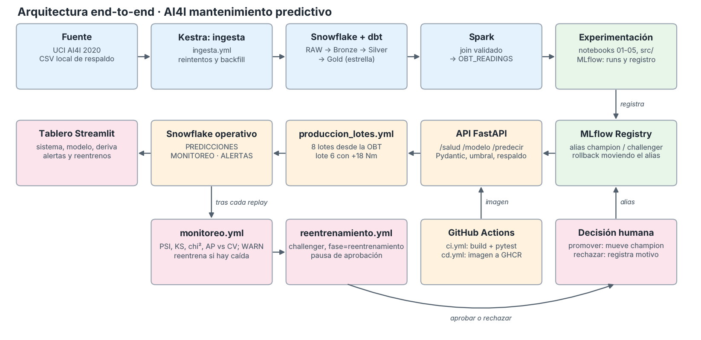

# PSet 04 · Operación del modelo AI4I

**Documento técnico del proyecto final de Ciencia de Datos.** Detección de falla en la lectura actual de una máquina (dataset AI4I 2020) operada de extremo a extremo: ingesta orquestada, modelo versionado, servicio de predicción, simulación de producción, monitoreo de deriva, reentrenamiento con aprobación humana, rollback y regla de respaldo.

Autor: Felipe Ron Andrade · Repositorio: <https://github.com/FelipeRon/Proyecto-Final-Data-Science>

## Video de demostración

> ▶️ **[Ver el video de demostración en Google Drive](https://drive.google.com/file/d/18C2aJ86TmV3iDoHwG5BmqobG-oICIeeF/view?usp=sharing)**
>
> `https://drive.google.com/file/d/18C2aJ86TmV3iDoHwG5BmqobG-oICIeeF/view?usp=sharing`

El video recorre la infraestructura local en funcionamiento: Compose integrado, flujos de Kestra, registro en MLflow, API y tablero, replay de lotes con deriva, alertas, pausa de aprobación del reentrenamiento, cambio y reversión del alias `champion` y activación de la regla de respaldo.

## Contenido

1. [Resumen técnico](#1-resumen-técnico)
2. [Problema y política de decisión](#2-problema-y-política-de-decisión)
3. [Arquitectura](#3-arquitectura)
4. [Pipeline de datos](#4-pipeline-de-datos-kestra--dbt--spark--snowflake)
5. [Modelo y registro en MLflow](#5-modelo-y-registro-en-mlflow)
6. [Servicio de predicción y validación](#6-servicio-de-predicción-y-validación)
7. [Patrón de despliegue y CI/CD](#7-patrón-de-despliegue-y-cicd)
8. [Simulación de producción y monitoreo de deriva](#8-simulación-de-producción-y-monitoreo-de-deriva)
9. [Alertas y reentrenamiento con aprobación](#9-alertas-y-reentrenamiento-con-aprobación)
10. [Rollback e interruptor de respaldo](#10-rollback-e-interruptor-de-respaldo)
11. [Pruebas automáticas](#11-pruebas-automáticas)
12. [Reproducibilidad: guía de ejecución](#12-reproducibilidad-guía-de-ejecución)
13. [Resultados](#13-resultados)
14. [Limitaciones](#14-limitaciones)
15. [Entregables y evidencia](#15-entregables-y-evidencia)

## 1. Resumen técnico

| Aspecto | Implementación |
|---|---|
| Datos | AI4I 2020 (UCI), 10.000 lecturas, 339 fallas (3,4 %), servidas desde `PSET2.OBT.OBT_READINGS` en Snowflake |
| Orquestación | Kestra v1.3 con PostgreSQL: ingesta, replay por lotes, monitoreo y reentrenamiento |
| Transformación | dbt (RAW → Bronze → Silver → Gold) y Spark 3.5.3 (Gold → OBT) |
| Modelo | `HistGradientBoostingClassifier` (scikit-learn), umbral 0,0906, AP de test 0,910 |
| Registro | MLflow, modelo `ai4i-mantenimiento-modelo`, alias `champion` (v1) y `challenger` |
| Servicio | FastAPI con validación Pydantic, imagen publicada en GHCR |
| Tablero | Streamlit sobre las tablas operativas de Snowflake |
| Despliegue | Batch: lote cada 15 min, lista de inspección dentro de 5 min del cierre |
| Monitoreo | PSI por variable, AP y costo por lote etiquetado, tasa de inspección, latencia p50/p95 |
| Control humano | Pausa de Kestra con decisión `promover` / `rechazar`, timeout de 72 h |
| Respaldo | `FORCE_FALLBACK=1` sirve la regla experta (desgaste ≥200 min o torque ≥60 Nm) |
| Calidad | 31 pruebas en `tests/`, workflows `ci.yml` y `cd.yml` en GitHub Actions |

## 2. Problema y política de decisión

- **Unidad de observación:** una lectura de sensores (tipo de producto L/M/H, temperatura de aire y de proceso, velocidad de rotación, torque y desgaste de herramienta).
- **Objetivo:** `machine_failure` binario en la lectura actual. El horizonte es el turno en curso.
- **Decisión:** el servicio recomienda *inspeccionar* si la probabilidad alcanza el umbral 0,09064, elegido con predicciones fuera de fold y un tope de 12 % de alertas. El supervisor confirma con evidencia de planta y puede anular la recomendación.
- **Métrica técnica:** Average Precision (AP), adecuada al desbalance de clases.
- **Métrica de negocio:** costo por 1.000 lecturas con USD 500 por inspección, USD 8.000 por falla omitida y USD 1.500 de costo residual por falla inspeccionada. Son supuestos a validar con mantenimiento y finanzas.
- **Línea base y respaldo:** regla experta que inspecciona con desgaste ≥200 min o torque ≥60 Nm.

## 3. Arquitectura



| Servicio (`docker-compose.yml`) | Función | Puerto local |
|---|---|---|
| `postgres` | Base de metadatos de Kestra | interno |
| `kestra` | Orquestación de flujos | [8080](http://127.0.0.1:8080) |
| `mlflow` | Tracking y registro de modelos | [5003](http://127.0.0.1:5003) |
| `api` | FastAPI, imagen `ghcr.io/feliperon/proyecto-final-data-science` | [8004](http://127.0.0.1:8004/docs) |
| `tablero` | Streamlit de monitoreo | [8504](http://127.0.0.1:8504) |
| `runner` | Trabajos de replay, reentrenamiento y restauración | bajo demanda |
| `spark` | Imagen de ingesta (Spark + dbt) | bajo demanda |

La trazabilidad se apoya en dos identificadores: la versión y el `run_id` del modelo en MLflow, y el SHA-256 canónico del snapshot de la OBT (`dbdb2601…9e1e`, registrado en `docs/dataset.json` y `docs/split.json`). Cada fila de monitoreo guarda además el Query ID de Snowflake con que se leyó la OBT.

| Carpeta | Contenido |
|---|---|
| `kestra/` | `ingesta.yml`, `produccion_lotes.yml`, `monitoreo.yml`, `reentrenamiento.yml` |
| `dbt/`, `spark/` | Modelos y pruebas dbt; `build_obt.py` |
| `src/` | Datos, pipeline de features, experimentos, métricas, `reentrenar.py`, `promover.py`, `portable.py` |
| `api/` | `main.py` y esquemas de entrada/salida |
| `monitoreo/` | `replay.py`, `deriva.py`, `alertas.py`, `tablero.py`, acceso a Snowflake |
| `notebooks/` | 01 EDA a 07 análisis de monitoreo, ejecutados con salidas |
| `docs/` | Evidencia (JSON/CSV), memo técnico, presentación, diagramas y verificaciones |

## 4. Pipeline de datos (Kestra · dbt · Spark · Snowflake)

1. **Ingesta (`kestra/ingesta.yml`, flujo `pset2.ai4i_pipeline`).** Descarga el CSV de UCI (con respaldo local si UCI no responde) y lo carga en `RAW.AI4I`.
2. **dbt.** Construye Bronze, Silver (con cuarentena de filas inválidas) y Gold (`FCT_READING`, `DIM_PRODUCT_TYPE`). Las pruebas `conservation`, `physical_contract` y `quarantine_empty` verifican conteos y rangos físicos.
3. **Spark.** `spark/build_obt.py` une hecho y dimensión en `OBT.OBT_READINGS` y valida que el join conserve las 10.000 filas e identificadores únicos.
4. **Snapshot.** El entrenamiento usa el snapshot de la OBT identificado por hash. El replay vuelve a leer la OBT en vivo y verifica que coincida con la partición congelada de `docs/split.json`.

La cuenta se configura con `docs/snowflake_setup.sql`. La construcción completa de RAW a OBT se verificó en una base vacía (`PSET2_VERIF`): `dbt build` pasó 20 de 20 y el hash de la OBT reconstruida coincidió con el del snapshot de entrenamiento ([cuarta verificación](docs/verificacion_reproducibilidad.md#construcción-de-raw-a-obt-en-una-base-nueva)).

## 5. Modelo y registro en MLflow

| Modelo | Fase | AP CV (media ± DE) | AP test | Costo test / 1.000 | Alias |
|---|---|---:|---:|---:|---|
| Dummy (prevalencia) | baseline | 0,034 ± 0,000 | — | — | — |
| Regla experta | baseline | 0,135 ± 0,029 | — | — | respaldo |
| HistGradientBoosting (`config_17`) | tuning | 0,879 ± 0,026 | **0,910** | USD 98.000 | `champion` (v1) |
| Random Forest (`config_13`) | tuning | 0,873 | 0,893 | — | `challenger` histórico (v2) |
| Reentrenado tras la deriva | reentrenamiento | — | — | — | `challenger` (v3) |

En test, el champion obtuvo ROC-AUC 0,985, recall 0,897, precisión 0,629 y tasa de inspección de 4,85 %. El run final es `d07d9f7f061848138579716948af2c6f`.

- El registro se entrega como respaldo portable: `docs/mlflow_snapshot.zip` con su SHA-256 en `docs/mlflow_snapshot.sha256`. `src.portable restore` lo restaura y `src.experimentos verify` reproduce la AP exacta del champion (0,9098503380639453).
- Cada run del reentrenamiento lleva el tag `fase=reentrenamiento`. `docs/reentrenamientos.csv` se obtiene con `mlflow.search_runs` filtrando por ese tag; `docs/corridas.csv` lista todas las corridas.
- La selección, el tuning, la ablación y la comparación con TabPFN y con prompting a un LLM están en `docs/seleccion.json`, `docs/tuning.json`, `docs/ablacion.json`, `docs/tabpfn.json` y `docs/llm.json`.

## 6. Servicio de predicción y validación

La API (`api/main.py`) resuelve `models:/ai4i-mantenimiento-modelo@champion` al arrancar y usa el mismo pipeline de features que el entrenamiento (`src/pipeline.py`).

| Método | Ruta | Respuesta |
|---|---|---|
| GET | `/salud` | Estado del servicio |
| GET | `/modelo` | Alias, versión y `run_id` servidos, o la regla si está en respaldo |
| POST | `/predecir` | Probabilidad, decisión (inspeccionar/continuar), versión y marca `respaldo` |
| GET | `/monitoreo` | Último lote y alertas desde `OBT.MONITOREO` y `OBT.ALERTAS` |
| GET | `/docs` | OpenAPI |

**Validación de entrada.** Los esquemas Pydantic (`api/esquemas.py`) exigen los seis campos con tipo estricto y valores finitos (positivos, desgaste ≥0), aceptan solo `product_type` L/M/H y rechazan cualquier campo adicional, como etiquetas o columnas de auditoría. Un campo faltante, un tipo inválido o un campo prohibido devuelven HTTP 422. Si el backend de Snowflake no está disponible, `/predecir` y `/monitoreo` devuelven 503.

**Auditoría.** Cada predicción aceptada se guarda en `OBT.PREDICCIONES` con la versión del modelo y su latencia. La latencia de scoring excluye la escritura del evento.

## 7. Patrón de despliegue y CI/CD

**Batch.** La decisión es una lista de inspección por turno, así que no exige respuesta por lectura. El piloto agrupa lecturas cada 15 minutos y publica la lista dentro de 5 minutos, con una espera máxima de 20 minutos. Online solo se justificaría si la decisión pasara a detener una máquina en segundos; las alarmas de seguridad siguen una vía independiente. Detalle en [`docs/despliegue.md`](docs/despliegue.md).

| Workflow | Disparo | Pasos |
|---|---|---|
| `.github/workflows/ci.yml` | push y pull request | Construye la imagen y ejecuta `pytest` |
| `.github/workflows/cd.yml` | merge a `main` y `workflow_dispatch` | Repite las pruebas y publica la imagen en GHCR como `:<sha>` y `:latest` |

El código se despliega de forma continua; el modelo cambia solo con aprobación humana (sección 9).

## 8. Simulación de producción y monitoreo de deriva

`monitoreo/replay.py` (orquestado por `kestra/produccion_lotes.yml`) puntúa el holdout en **8 lotes de 250 lecturas** con el champion fijado en `docs/seleccion.json`. Las etiquetas se publican un lote después. En el **lote 6 se suman 18 Nm al torque** para inducir deriva de datos.

Por lote se calculan, en `monitoreo/deriva.py`:

- **Deriva de datos:** PSI por variable frente a la distribución de entrenamiento (con prueba KS/χ² de apoyo) y calidad de datos (faltantes, valores fuera de rango o categorías nuevas).
- **Desempeño:** AP, ROC-AUC, recall, precisión, costo por 1.000 y tasa de inspección cuando llegan las etiquetas.
- **Servicio:** latencia p50/p95 y percentiles de la probabilidad.

| Lote | AP | PSI máx. | Tasa de inspección | Costo modelo / 1.000 | Costo regla / 1.000 | Diagnóstico |
|---:|---:|---:|---:|---:|---:|---|
| 1 | 0,940 | 0,056 | 5,2 % | 112.000 | 194.000 | estable |
| 2 | 0,962 | 0,072 | 3,6 % | 60.000 | 164.000 | estable |
| 3 | 1,000 | 0,050 | 4,4 % | 64.000 | 234.000 | estable |
| 4 | 1,000 | 0,052 | 5,2 % | 68.000 | 174.000 | estable |
| 5 | 0,965 | 0,064 | 7,2 % | 96.000 | 206.000 | estable |
| **6** | **0,668** | **2,633** | **62,4 %** | **404.000** | 340.000 | **deriva de datos con impacto** |
| 7 | 0,876 | 0,067 | 4,0 % | 94.000 | 190.000 | estable |
| 8 | 0,707 | 0,044 | 3,6 % | 144.000 | 198.000 | caída aislada de AP (compatible con deriva conceptual) |

El mayor PSI de los lotes de control fue 0,072 y el del lote alterado 2,633, de modo que el corte 0,25 separa ambos grupos en este ensayo. La latencia p95 se mantuvo entre 3,5 y 5,2 ms por lote. El notebook [`07_analisis_monitoreo.ipynb`](notebooks/07_analisis_monitoreo.ipynb) separa el desplazamiento de torque de un cambio inducido de la relación entrada/etiqueta (AP de 0,940 a 0,022 con sensores y prevalencia constantes). El tablero de Streamlit marca los lotes con alertas y el reentrenamiento.

## 9. Alertas y reentrenamiento con aprobación

`kestra/monitoreo.yml` corre al terminar cada replay y aplica el catálogo de `monitoreo/alertas.py`. Cada alerta se escribe como WARN en el log de Kestra y se persiste en `OBT.ALERTAS`.

| Métrica | Umbral | Ventana | Severidad | Destinatario | Acción |
|---|---|---|---|---|---|
| PSI por feature | > 0,25 | 1 lote | Alta | Datos y Mantenimiento | Revisar sensor y fuente. Reentrenar solo si además cae el desempeño. |
| AP del lote etiquetado | < 0,827 (media CV − 2 DE) | 1 lote | Media | Datos | Revisar etiquetas. Con PSI alto o en 2 lotes seguidos, reentrenar. |
| Tasa de inspección | > 12 % | 1 lote | Alta | Mantenimiento | Validar capacidad. En 2 lotes seguidos, activar `FORCE_FALLBACK`. |
| Costo por 1.000 del modelo | > costo de la regla | 2 lotes | Alta | Mantenimiento y Finanzas | Activar `FORCE_FALLBACK` y revisar el modelo. |

**Disparo del reentrenamiento.** Solo se reentrena ante *deriva con impacto* (PSI > 0,25 y AP bajo el piso en el mismo lote) o ante caída de AP en dos lotes etiquetados seguidos. La deriva sin caída de desempeño solo genera la alerta de revisión. La firma del evento (Query ID, lote y motivo) se guarda en el KV de Kestra para no reentrenar dos veces por la misma alerta. En el replay, el lote 6 dispara el reentrenamiento y el lote 8 queda como alerta de revisión.

**Flujo `kestra/reentrenamiento.yml`:**

1. `src/reentrenar.py` entrena el candidato con los datos etiquetados disponibles (9.500 filas), lo registra con alias `challenger` y tag `fase=reentrenamiento`, y archiva el ciclo previo en `docs/historial_reentrenamiento/`.
2. Compara champion y candidato en los lotes 7 y 8 y escribe en el log la mejora de costo y el criterio de promoción.
3. **Pausa** hasta la decisión humana. El responsable reanuda desde la interfaz de Kestra con `decision` (`promover` o `rechazar`), `responsable` y `comentario`. Sin respuesta en 72 horas la ejecución se cancela y el champion no cambia.
4. `src/promover.py` aplica la decisión: solo mueve `champion` si el candidato cumple el criterio, deja la decisión en etiquetas de la versión en MLflow y guarda en `docs/aprobacion.json` la versión anterior para el rollback.
5. La tarea final consulta `GET /modelo` para confirmar la versión servida.

**Resultado del ciclo documentado** (`docs/reentrenamiento.json`): el candidato (v3) obtuvo una diferencia media de costo de −USD 8.000 por 1.000 lecturas frente al champion (−12.000 en el lote 7 y −4.000 en el lote 8), con dispersión de CV de 1.606. No califica, así que se rechazó y el champion v1 siguió sirviendo.

## 10. Rollback e interruptor de respaldo

**Rollback.** La API sirve siempre el alias `champion`. Para revertir se reasigna ese alias a la versión previa registrada (la de `docs/aprobacion.json`) y se comprueba `GET /modelo` y una predicción válida. El ensayo movió el alias 1 → 2 → 1 y, en el ciclo orquestado, 1 → 6 → 1, y `/modelo` reflejó cada cambio.

**Interruptor de respaldo.** Con `FORCE_FALLBACK=1` en `.env` y `docker compose up -d api`, la API aplica la regla experta (`regla-v1`) e indica `respaldo=true` en cada respuesta. La API también cae a la regla si el registro no carga. Se activa durante el siguiente lote si la tasa de inspección supera 12 % en dos lotes consecutivos o si el costo del champion excede el de la regla en dos lotes etiquetados. Para volver al modelo se exigen dos lotes con tasa ≤12 % y costo ≤ regla, validados por Mantenimiento. Detalle en [`docs/criterio_retirada.md`](docs/criterio_retirada.md).

## 11. Pruebas automáticas

| Archivo | Qué verifica |
|---|---|
| `tests/test_contrato.py` | Esquema de la API: 200 en entrada válida y 422 en campos faltantes, tipos o valores inválidos |
| `tests/test_contrato_pset3.py` | Las seis entradas del fixture de PSET-03 y el rechazo de campos de etiqueta y auditoría |
| `tests/test_pipeline.py` | Pipeline de features: unidades derivadas, independencia de etiquetas e identificadores, y misma salida por lectura y por lote |
| `tests/test_modelo.py` | El champion reproduce la AP y el costo registrados |
| `tests/test_comportamiento.py` | +100 min de desgaste o +20 Nm de torque suben la probabilidad; una sobrecarga evidente se inspecciona; sin registro la API responde con la regla y `respaldo=true` |
| `tests/test_disparo.py` | Catálogo de alertas y regla de disparo, promoción, rechazo, bloqueo del candidato que no califica y orden del replay con Snowflake |

En total pasan 31 pruebas. Usan un registro MLflow local aislado y no requieren credenciales.

## 12. Reproducibilidad: guía de ejecución

Los comandos son de PowerShell con Docker Desktop y se ejecutan desde la raíz del repositorio.

### 12.1 Configuración

```powershell
Copy-Item .env.example .env
```

Completa en `.env` las variables de Snowflake (`SNOWFLAKE_ACCOUNT`, usuario, rol, warehouse y base) y los accesos de Kestra. Guarda la llave privada en `secrets/snowflake_key.p8` o ajusta `SNOWFLAKE_SECRETS_DIR`. El rol necesita lectura de `PSET2.OBT.OBT_READINGS` y creación/escritura de tablas en el esquema OBT. Pon entre comillas dobles los valores con espacios, porque los flujos de Kestra cargan el archivo con `set -a; . .env`. No se versionan claves ni secretos.

### 12.2 Infraestructura integrada

Ejecuta este bloque una sola vez por carpeta de trabajo. Restaura el registro antes del primer arranque de MLflow.

```powershell
New-Item -ItemType Directory -Force data | Out-Null
docker compose config --quiet
docker compose build runner
docker compose run --rm --no-deps -v "${PWD}/data:/app/data" runner python -m src.portable restore
docker compose pull api
docker compose up -d --no-build mlflow kestra api tablero
```

`API_IMAGE` en `.env` permite fijar la imagen de un commit (`ghcr.io/feliperon/proyecto-final-data-science:<sha>`) o usar la local (`ai4i-pset4:local`). En un equipo con otra copia activa, usa puertos y nombre de proyecto distintos.

### 12.3 API

```powershell
Invoke-RestMethod http://127.0.0.1:8004/salud
Invoke-RestMethod http://127.0.0.1:8004/modelo

$body = @{
  product_type='L'; air_temperature_k=300; process_temperature_k=310
  rotational_speed_rpm=1500; torque_nm=40; tool_wear_min=100
} | ConvertTo-Json
Invoke-RestMethod http://127.0.0.1:8004/predecir -Method Post -ContentType application/json -Body $body
```

Cambia un campo a un valor inválido para comprobar la respuesta 422.

### 12.4 Pruebas

```powershell
docker run --rm --mount "type=bind,source=$((Get-Location).Path)/tests,target=/app/tests,readonly" ai4i-pset4:local python -m pytest -q
```

### 12.5 Ingesta desde la fuente

```powershell
docker compose build spark
docker compose run --rm spark dbt debug --project-dir /app/dbt --profiles-dir /app/dbt
```

Importa los YAML de `kestra/` en [Kestra](http://127.0.0.1:8080) y ejecuta `ai4i_pipeline`. El cron de ingesta se entrega deshabilitado para que la ejecución sea explícita. En Docker Desktop, `HOST_PROJECT_DIR` y `KESTRA_SECRETS_DIR` deben ser rutas absolutas visibles para el motor Linux.

### 12.6 Replay, monitoreo y reentrenamiento

Sin Kestra:

```powershell
docker compose run --rm --no-deps runner
Invoke-RestMethod http://127.0.0.1:8004/monitoreo
docker compose run --rm runner python -m src.reentrenar
```

Con Kestra: importa `kestra/monitoreo.yml`, luego `kestra/produccion_lotes.yml` y `kestra/reentrenamiento.yml`, y ejecuta `produccion_lotes`. Los runners usan `KESTRA_MLFLOW_URI` y `KESTRA_PREDICTION_URI` para llegar a los puertos del host y `KESTRA_RUNNER_IMAGE` para la imagen. `python -m monitoreo.publicar` carga resultados históricos desde CSV.

### 12.7 Respaldo y rollback

- Respaldo: agrega `FORCE_FALLBACK=1` a `.env`, ejecuta `docker compose up -d api` y consulta `/modelo`. Retira el valor y recrea el servicio al terminar.
- Rollback: en un registro de demostración, reasigna `champion` a la versión anterior desde MLflow y consulta `GET /modelo`. Devuelve el alias original al terminar.

### 12.8 Documentos

El memo y los diagramas se regeneran con `python scripts/memo.py` y `python scripts/diagramas.py`.

## 13. Resultados

- **Modelo.** AP de test 0,910 frente a 0,135 de la regla experta en CV y 0,034 del modelo trivial.
- **Negocio (simulación).** En los 8 lotes, el costo medio del modelo fue USD 130.250 por 1.000 lecturas, frente a USD 212.500 de la regla y USD 272.000 sin inspeccionar: un ahorro de 38,7 % frente a la regla. El modelo superó a la regla en siete de ocho lotes; en el lote 6 la deriva disparó las inspecciones y costó más.
- **Monitoreo.** El PSI detectó la deriva inducida (2,633 frente a ≤0,072 en los controles) y el catálogo distinguió la deriva con impacto (lote 6) de la caída aislada (lote 8).
- **Reentrenamiento.** El candidato no mejoró el costo (−USD 8.000), así que la regla de promoción lo rechazó y el champion siguió en servicio.
- **Reproducibilidad.** Cuatro verificaciones desde clones limpios: la restauración de MLflow reprodujo la AP exacta; el ciclo de Kestra contra Snowflake ejecutó replay, alertas, disparo sin duplicados, pausa, rechazo, bloqueo de una promoción inválida y movimiento del alias; y la cadena RAW → OBT en una base nueva reprodujo el hash del snapshot. Ver [`docs/verificacion_reproducibilidad.md`](docs/verificacion_reproducibilidad.md).

**Recomendación:** ajustar y escalar a un piloto supervisado, con el modelo en paralelo a la regla, antes de cualquier uso en producción.

## 14. Limitaciones

- AI4I es sintético y no tiene marcas temporales reales. El replay reutiliza el holdout permutado y la deriva del lote 6 es artificial.
- Los costos son supuestos y deben validarse con mantenimiento y finanzas.
- `kestra/produccion_lotes.yml` procesa los ocho lotes en una sola tarea en vez de una ejecución por período.
- El replay puntúa en lote, así que no mide tasas HTTP 4xx/5xx de tráfico real.
- Solo las dependencias directas están fijadas en `requirements.txt` (la ingesta usa `requirements-ingesta.lock`).

## 15. Entregables y evidencia

- **[Video de demostración](https://drive.google.com/file/d/18C2aJ86TmV3iDoHwG5BmqobG-oICIeeF/view?usp=sharing)**
- [Memo técnico (PDF)](docs/PSet4_memo_Ron_Andrade.pdf) y [presentación ejecutiva (PDF)](docs/PSet4_presentacion_Ron_Andrade.pdf)
- [Arquitectura](docs/arquitectura.png) y [modelo dimensional](docs/modelo_dimensional.png)
- [Diseño de despliegue y operación](docs/despliegue.md) y [criterio de retirada](docs/criterio_retirada.md)
- [Verificación desde clones limpios](docs/verificacion_reproducibilidad.md), [auditoría de la rúbrica](docs/auditoria_rubrica.md) y [calificación estimada](docs/calificacion_estimada.md)
- [Cambios respecto a los PSets anteriores](docs/cambios.md), [revisión de PSET-03](docs/pset3_revision/) e [historial de memos](docs/historial/)
- Evidencia de ejecución: `docs/predicciones.csv`, `monitoreo.csv`, `alertas.csv`, `corridas.csv`, `reentrenamientos.csv`, `replay.json`, `reentrenamiento.json` y `verificacion_rubrica.json`

**Continuidad con PSET-03.** Esta entrega conserva el snapshot de Snowflake y el modelo de referencia de `docs/dataset.json` y `docs/seleccion.json`. `docs/pset3_revision/` reúne la reconsulta, la EDA ampliada, el contrato de inferencia y las pruebas suplementarias.
